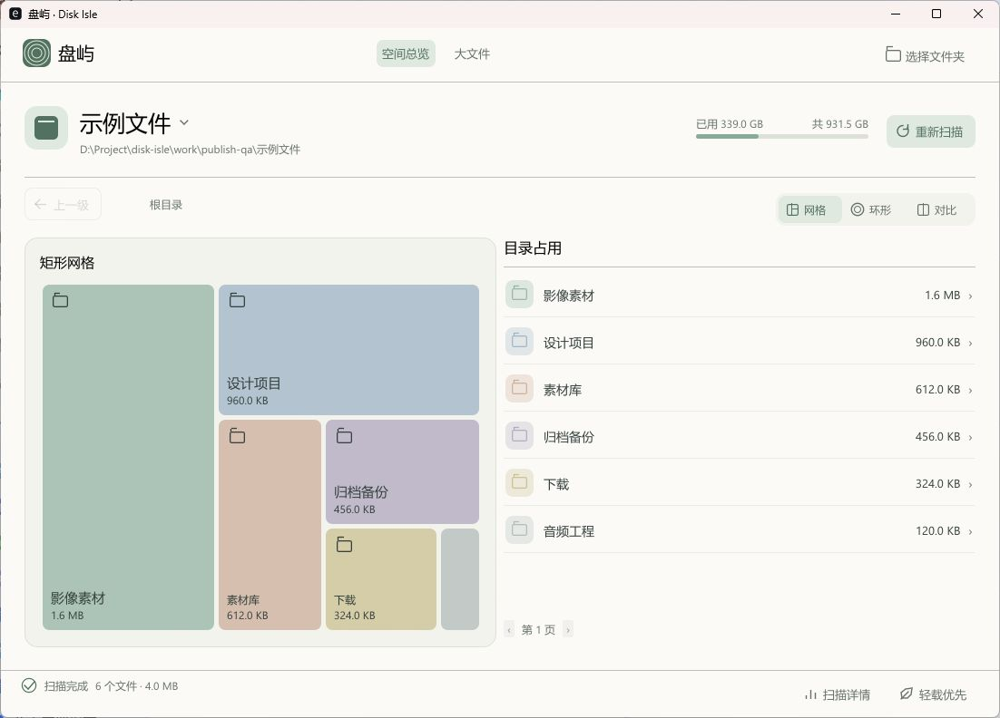

# 盘屿 · Disk Isle

盘屿是一款中文优先的 Windows 便携式磁盘空间分析工具，用于查看文件和目录占用、定位大文件。

通过网格、环形和同屏对比视图浏览磁盘，结合容量列表逐层查找。扫描过程支持负载调节、暂停与继续，完成后保留可随时查看的统计结果。

A portable disk space analyzer for Windows, built with Rust.

[下载 Windows 便携版](https://github.com/BeamusWayne/disk-isle/releases/latest) · [版本记录](https://github.com/BeamusWayne/disk-isle/releases) · [MIT 许可证](LICENSE)

## 下载与启动

1. 从 Releases 下载 Windows x64 便携包。
2. 解压，双击 DiskIsle.exe。
3. 选择磁盘或文件夹，开始扫描。

当前版本为 0.2.0，便携包约 3.2 MB。运行时已静态编译进 EXE，程序会加载 Windows 系统字体，并使用 OpenGL 显卡驱动绘制界面。

已在 Windows 11 x64 本机验证运行。Windows 10 x64 的兼容性仍需进一步验证，当前构建尚未数字签名。

## 界面与功能

上图为原生 Windows 应用，目录内容为演示数据。

- **三种视图** — 网格按占用面积排列，环形展示目录层级，同屏视图同时查看两者。
- **大文件排行** — 按实际占用排序，分页浏览文件，并在资源管理器中定位。
- **目录导航** — 点击色块或列表进入目录，通过路径栏或“上一级”返回，支持 Alt + 左箭头。
- **扫描控制** — 轻载优先与均衡两档，可随时暂停、继续或停止。
- **完成反馈** — 六秒轻提示保留当前操作焦点，底部持续显示结果，未读取项可在详情中查看。

## 扫描模式与统计规则

默认的“轻载优先”模式，以约一颗逻辑核心 25% 的 CPU 时间占比为扫描线程目标。“均衡”模式的目标约为 55%。这些数值用于调节扫描节奏，整机占用还受到界面、驱动、文件系统和其他进程的影响。

扫描索引分批写入 SQLite，界面每页读取 80 项。图表最多显示 48 个直接子项，较小项汇总为“其他项”，完整内容可在列表中分页查看。环形图同时展示最多三层目录，点击后可继续深入。

文件按磁盘实际分配空间统计。硬链接在首次遇到的位置计入占用，重复条目保留并显示零额外占用。目录链接与挂载点保留条目，遍历时跳过。

文件系统元数据、无权限目录和扫描期间的文件变化，会使统计总计与系统显示的已用空间存在差额。读取失败的路径和原因可在“扫描详情”中查看。

## 实测记录与已知限制

以下为扫描核心在本机 NTFS 磁盘上的命令行测试结果。

| 测试场景 | 模式 | 耗时 | 扫描进程峰值内存 |
| --- | --- | --- | --- |
| 1 TB 数据盘，约 65 万文件、3.8 万目录 | 均衡 | 约 72 秒 | 约 21 MB |
| 60,003 个文件的混合测试集 | 轻载优先 | 约 1.47 秒 | 约 20 MB |

混合测试集包含硬链接、中文与长路径，以及逻辑大小为 8 TiB 的稀疏文件。已核对目录汇总和 SQLite 完整性，并验证目录链接循环、扫描中目录消失、暂停继续与停止唤醒。

0.2.0 的自动化交互测试覆盖完成提示计时、悬停与聚焦延时、焦点保持、父目录导航、未读取项详情，以及重新扫描时清理旧提示。

以上内存数据来自命令行扫描进程。窗口进程包含字体与图形资源，本机观察约 200 MB。耗时与内存会随机器、目录结构和负载变化。百万级文件与物理拔盘场景仍需进一步实测。

设置与扫描索引保存在以下目录。

    %LOCALAPPDATA%\DiskIsle

重新扫描会清理上一次扫描的缓存。七天前的扫描缓存会在启动新扫描时尝试清理。关闭程序后，再次打开需要重新扫描。

## 从源码构建

在 Windows 上安装 Rust 稳定版的 MSVC 工具链，以及 Visual Studio C++ Build Tools，然后运行以下命令。

    git clone https://github.com/BeamusWayne/disk-isle.git
    cd disk-isle
    cargo build --release --locked

构建产物位于以下位置。

    target/x86_64-pc-windows-msvc/release/disk-isle.exe

运行测试。

    cargo test --locked

## 命令行扫描

命令行入口使用同一扫描核心，并将结果写入 JSON 报告。

    DiskIsle.exe --scan D:\ --report report.json
    DiskIsle.exe --scan D:\ --profile balanced --report report.json

也可将文件夹路径作为第一个参数，直接打开扫描窗口。

    DiskIsle.exe "D:\Media"

## 反馈与贡献

欢迎通过 Issues 报告问题或提出建议。反馈扫描问题时，请提供 Windows 版本、文件系统、扫描规模、所选模式和复现步骤。日志与截图中涉及的私人路径可先作遮盖。

## 许可证

本项目使用 [MIT 许可证](LICENSE)。第三方组件的许可与声明见 [THIRD_PARTY_NOTICES.txt](THIRD_PARTY_NOTICES.txt)。
